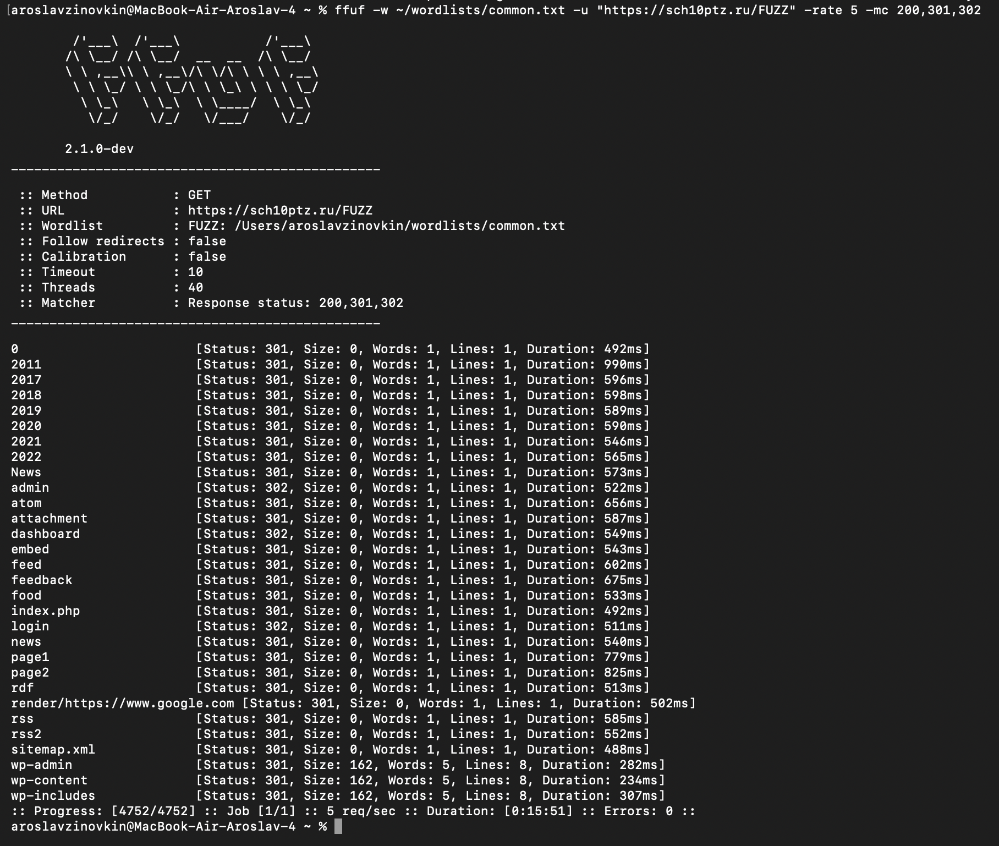
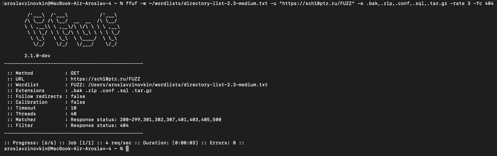
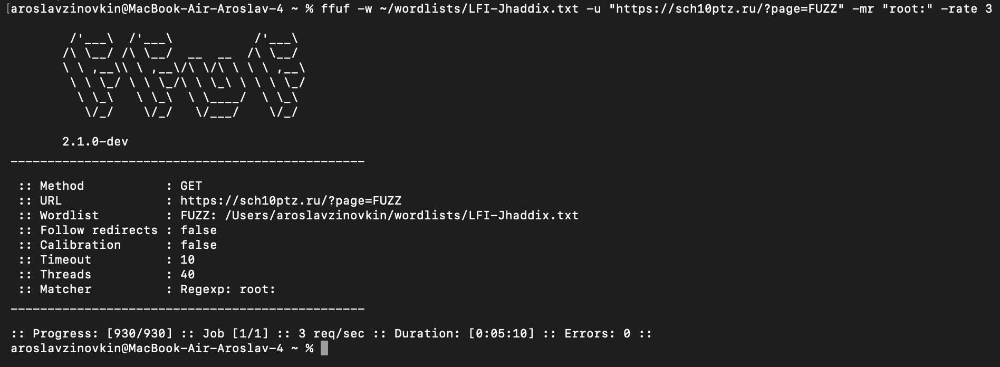

# Задание со здездочкой

Аккуратненько сейчас будем ~~дудосить~~ проверять сайт на уязвимости. Одно из уточнений: я подумал, что будет не так здорово просто с помощью `curl` проверять узявимости. Как будто не так много информации даст эта команда (может я был не прав). Короче суть в том, что ниже я хотел разобраться, как работает `fuff` на практике. 

Три уязвимости:
* Перебор страниц, директорий и скрытых файлов
* Тестирование Path Traversal (Выход за пределы директории)
* Поиск скрытых параметров

Я подумал, что будет приколдесно все сделать все через `ffuf` (как я это выше написал). Поглядим, что из этого выйдет

## Перебор страниц, директорий и скрытых файлов
Командой ниже мы базово перебираем директории:

`-rate 5` отправляет не более 5 запросов в секунду (чтоб ничего не поломать), а `-mc 200,301,302` показывает только ответы с кодами 200 (ОК), 301/302 (перенаправления)

Обнаружены были директории `wp-admin`, `wp-content`, административные панели (admin, login, dashboard). Как будто стоит задуматься над тем, чтобы эти файлы не были видны, так как видимость этих файлов доказывает, что к ним можно пробраться. 

Далее ищем резервные копии и файлы конфигурации командой:

 

`-e` автоматически подставляй указанные расширения к каждому слову из словаря, а `-fc 404` мощно фильтровал ответы с ошибкой 404

Тут пустовато, значит никаких файлов скрытых нет.

## Тестирование Path Traversal

 

`-mr "root:"` вообще тут красавчик, он отфильтрует результаты и покажет только те ответы, в теле которых содержится строка "root:" (характерная для файла /etc/passwd). Возможно через эти отфильтрованные ответы можно найти лазейку для дальнейшего нахождения уязвимости

Тут нет ничего приколдесного, значит строки, где есть root не видны для дефолтных бедолаг

## Поиск скрытых параметров

`ffuf -w /usr/share/wordlists/seclists/Discovery/Web-Content/burp-parameter-names.txt -u "https://sch10ptz.ru" -rate 5 -fs 1234`

`-fs 1234` значит заменить 1234 на размер обычного ответа страницы (длину в байтах). Все запросы с несуществующими параметрами вернут одинаковый размер. Если какой-то параметр существует, размер ответа изменится, и ffuf его подсветит (Эти проверки пароля меня уже опять переносят в первую лр по nginx...)

Вывод этой команды я смотрел с таким лицом:

 

Потому что там было очень много строк со статусом 200 и очень мало строк со статусом 301 (перенаправление). Вывод я боюсь вставлять, потому что там слишком много строк. Но я нашел файлы admin и похожие, что дает наводку на то, что можно дальше куда-то залезать аккуратненько

## Вывод 

Критических уязвимости нет, не смог я почувствовать себя мегахакером, но зато я попробовал новый для себя `fuff` для анализа скрытых файлов. Пускай КАДР не будет поражен такими же уязвимостями. 

Всем спасибо, картинка для вайба:

 

