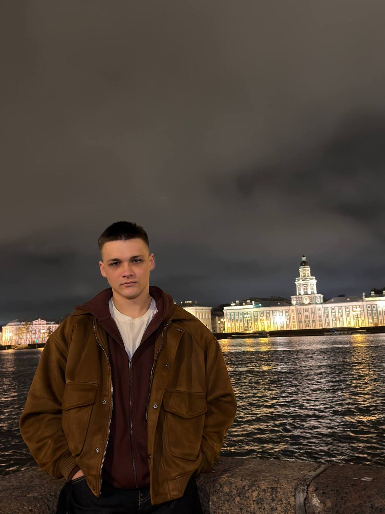
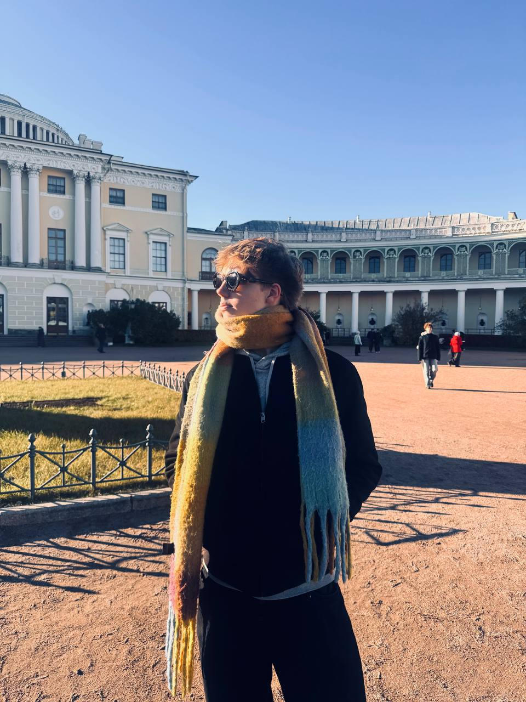
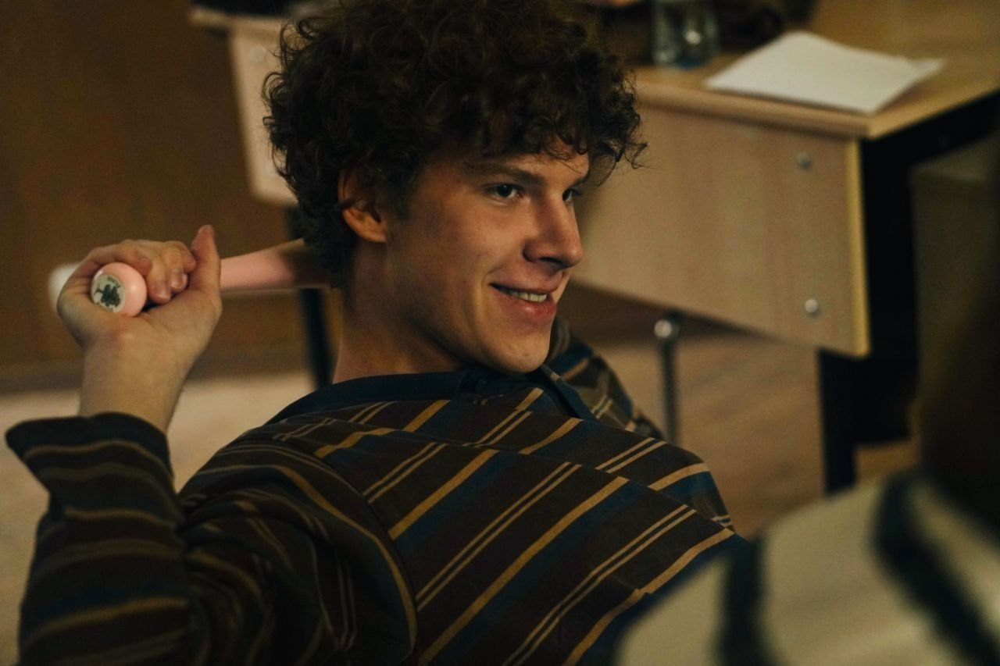
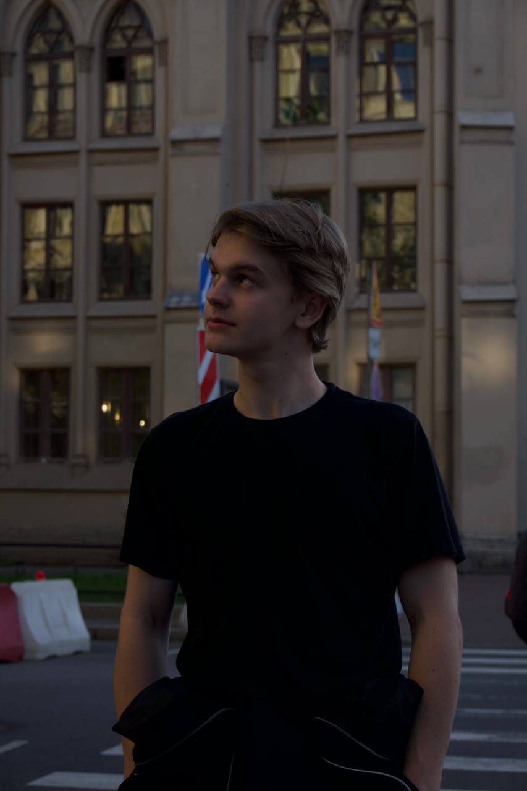

# Облака — мегалабораторные работы

Мегарепозиторий мегакоманды **Красавчики**

| Работа | Инструкция |
|---|---|
| [Lab0](Lab0/) | [Полный запуск через Docker](Lab0/README.md) |
| [Lab1](Lab1/) | [Lab1/README.md](Lab1/README.md) |

Вся подробные и менее подробные изменения будут представлены в md файлах по ссылкам выше

Наша команда очень старалась аккуратненько и не спеша реализовать наш мегапроект **КАДР**б который мы будем эксплуатировать в следущих лабораторных работах

## Наша команда

### РУСЛАН

* Участвовал на шахматном турнире против 50 нейронок Chat GPT 6 Astra (он всем проиграл)
* Гениально пародирует КОГО УГОДНО
* Любимый мем - Игорь Чайка

### МАКСИМ

* Являлся диджеем на общей встрече проекта КАДР и был ответственным за белорусскую свагу
* Параллельно борется за работоспособность нашего проекта и с желанием пить пиво (мы все боремся)
* Живет в общаге с завозным соседом Саймоном

### ЯРИК КУДРЯВЫЙ

* Дизайнер нашего КАДРА. Школа мегабайта его боялась
* Тот самый человек, который смог сбежать из Саратова
* Этот бро уже успел сделать предложение и отменить свадьбу (посвят ТиНТа никого не щадит)

### ЯРИК САЛЬТО

* Рукописец (клаважматель) данного md файла
* Амбассадор слова "Красавчик"
* Скромняга, который очень любит своих кентафариков по команде
